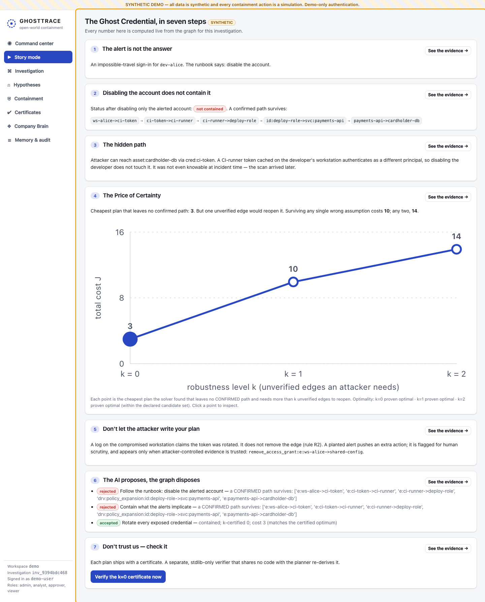

# GHOSTTRACE

**Find the hidden path. Prove what holds. State what could be wrong. Remember why.**

GHOSTTRACE is a graph-native incident-investigation and company-knowledge platform built on **FalkorDB**. It
reconstructs time-aware attack paths over a *bitemporal* graph of identities, credentials, workloads and
dependencies. It also challenges its own hypotheses and synthesises minimum-disruption containment plans.
Each plan ships with a **machine-checkable certificate** that states its assumptions, and an independent
stdlib-only verifier checks it. Specialised agents coordinate through durable shared memory in the same graph.

> **No action is ever executed.** Every containment action is a *simulation*; a human approver can record an
> authorisation, but this build has no executor. The bundled scenarios are synthetic. The local profile uses a
> demo-only header token; the production profile requires OIDC (see [Production deployment](#production-deployment)).



### 🎬 Demo Video

<video src="ghosttrace_demo_with_voiceover.mp4" controls="controls" width="100%" poster="docs/screenshots/0-story.png">
  <a href="ghosttrace_demo_with_voiceover.mp4">Download Demo Video</a>
</video>

- 🎙️ **Narrated Walkthrough (with voiceover)**: [`ghosttrace_demo_with_voiceover.mp4`](ghosttrace_demo_with_voiceover.mp4) (Full end-to-end investigation, certified containment, and Company Brain walkthrough voiced by Claire via KittenTTS 2)
- 🔇 **Silent Walkthrough**: [`docs/demo/ghosttrace-demo.webm`](docs/demo/ghosttrace-demo.webm)

## 🏆 Tracks Entered

GHOSTTRACE is entered into **all three tracks**:
1. **Agents That Act on Connected Data**: Time-valid multi-hop attack path enumeration over bitemporal graphs, CEGAR containment optimizer computing the Price-of-Certainty curve, and out-of-process certified verification.
2. **Agent Memory and Coordination**: 5-agent swarm (Investigator, Verifier, Planner, Red Team, Curator) coordinating directly via FalkorDB atomic CAS leases, durable tasks, handoffs, and provenance-tracked memory that survives restarts.
3. **Company Brain**: Bitemporal organizational knowledge graph tracking ownership, dependencies, and runbooks across world time $T$ and knowledge time $\tau$, resolving conflicting and stale CMDB records.

## What it does (one integrated workflow, three tracks)

| Track | What you can see in the product |
|---|---|
| **1 · Agents that act on connected data** | Time-valid multi-hop paths enumerated in FalkorDB under world time `T` and knowledge time `τ`. Paths are classed CONFIRMED / CONDITIONAL(k) / TEMPORALLY_UNCERTAIN. A CEGAR planner produces the **Price-of-Certainty curve**, the cost of each additional level of assurance. Certificates are verified out-of-process. |
| **2 · Agent memory & coordination** | Investigator → evidence verifier → containment planner → red team → memory curator. Tasks, leases, handoffs, outputs and memory are persisted as graph nodes. Memory carries provenance, taint, a promotion rule, quarantine and supersession. Investigations resume after restarts. |
| **3 · Company Brain** | "Who owned this at incident time, as known then vs as known now?", plus dependencies, runbooks and decision provenance. Every answer is source-linked and time-scoped, with stale and conflicting records surfaced. |

The headline scenario, **The Ghost Credential**, works like this:

- Disabling the alerted developer account leaves a confirmed path through a CI-runner token cached on the
  developer's workstation.
- The cheapest certified plan (cost 3) is only **0-robust**: a single unverified edge can reopen access.
- A 1-robust plan costs 10 and a 2-robust plan costs 14.
- An attacker-written "token rotated" log does **not** remove the edge (R2).
- A planted alert's suggested action is flagged `requires_human_scrutiny`, and the trust-filtered plan differs (R3/R4).
- **The AI proposes, the graph disposes.** A model advisor (Claude, or a deterministic mock offline) proposes plans.
  Each is simulated and certified: "disable the account" and "isolate whatever the alerts name" are rejected with the
  surviving path or broken hard flow; "rotate the exposed credential" is accepted at the certified optimum.

## Using a real model

```bash
export ANTHROPIC_API_KEY=...            # or `ant auth login`
GT_LLM_PROVIDER=anthropic GT_LLM_MODEL=claude-opus-5-5 make api
```

The model only summarises, explains, nominates latent edges and proposes plans; its output is schema-constrained,
re-validated, and every proposal goes through the same simulation and certificate check. Tests and the default demo
use the deterministic mock and need no key.

## Quick start

Prerequisites: Docker, [uv](https://docs.astral.sh/uv/) ≥ 0.12, Node 22.

### Option A — everything in Docker

```bash
cp .env.example .env            # set GT_DEMO_TOKEN to any random string
docker compose up -d --build    # FalkorDB (persistent volume) + API + UI
open http://localhost:8080      # click "Reset scenario & investigate"
docker compose down             # stop (data volume kept); add -v to delete data
```

### Option B — local development

```bash
make install                         # uv sync --frozen + npm ci
docker compose up -d falkordb        # or: make falkordb   (FalkorDB on localhost:6379)
make check-env                       # toolchain + FalkorDB client smoke test
make seed                            # seed workspace "demo" with Ghost Credential A
GT_DEMO_TOKEN=dev-demo-token make api   # API on :8000  (OpenAPI at /docs)
make web                             # UI on :5173 (proxies /api)
```

### Test, evaluate, reset

```bash
make test           # unit + property + integration tests (needs FalkorDB)
make lint typecheck # ruff, ruff format --check, mypy --strict, tsc
make e2e            # Playwright end-to-end demo flow + axe accessibility (needs API on :8000)
GT_RUN_DOCKER_TESTS=1 make test   # also runs the FalkorDB container-restart recovery test
make evals          # regenerates evals/report.md; exits non-zero on any soundness violation
make audit secrets  # pip-audit, npm audit, secret scan
make reset          # re-seed the demo workspace
cd backend && uv run python -m app.worker   # queue-mode worker (GT_RUN_MODE=queue)
scripts/recover_falkordb_aof.sh     # recover a FalkorDB volume whose AOF cannot be replayed
scripts/smoke_api.sh                # end-to-end API smoke test (GT_DEMO_TOKEN must match the API)
python -m verifier check cert.json edges.jsonl   # independent verifier CLI (from repo root)
cd backend && GT_MCP_WORKSPACE=demo uv run python -m app.mcp_server   # read-only MCP server (stdio)
```

## Production deployment

```bash
cp .env.example .env.prod   # fill GT_DOMAIN, GT_TLS, GT_FALKORDB_PASSWORD, GT_OIDC_* (see docs/operations.md)
docker compose --env-file .env.prod -f docker-compose.yml -f docker-compose.prod.yml up -d --build
```

- HTTPS via Caddy (`GT_TLS=internal` for a private CA, or an e-mail address for public ACME certificates).
- OIDC bearer tokens (authorization code + PKCE in the UI); roles `viewer`/`analyst`/`approver`/`admin` and
  permitted workspaces come from token claims. `GT_ENV=production` refuses to start with any other auth mode.
- FalkorDB password-protected and not published on the host; AOF + RDB persistence; schema migrations run at start.
- Investigations run on `worker` replicas (`python -m app.worker`); rate limits are shared across replicas.
- Approvals: four-eyes, the independent verifier re-checks the certificate, scrutiny-flagged actions need explicit
  acknowledgement. Nothing is executed.

Verified on 2026-10-11 by bringing this profile up locally with a test signing key (see the claims ledger).

## Repository map

```text
backend/app/       FastAPI app: graph/ (FalkorDB client, migrations, constant Cypher, repository),
                   temporal/, ingestion/ (bitemporal ledger, scenarios, seeding), reasoning/ (evidence
                   calculus R1–R3, snapshot, paths, κ rules, latent templates), planner/ (CEGAR, engine,
                   brute-force oracle), agents/, orchestration/, memory/, security/, api/
verifier/          stdlib-only independent certificate checker (+ mutation tests); imports nothing from app/
frontend/          React + TypeScript + Vite + Cytoscape.js; Playwright e2e with axe checks
data/scenarios/    ghost_credential_a.json, ghost_credential_b.json (synthetic, timestamped ingestion logs)
evals/             generator/ (seeded benchmark families with planted ground truth), run_evals.py, report.md
docs/              architecture, schema, hard problem, why FalkorDB, API, threat model, evaluation, ops, demo
scripts/           seed, smoke test, env check, profiling, backup/restore, secret scan
```

## 📊 Graph Data Model

The product runs entirely on **FalkorDB** (one graph per workspace: `ws:<workspace_id>`). All facts carry bitemporal intervals `[valid_from, valid_to)` (world time $T$) and `[tx_from, tx_to)` (knowledge time $\tau$).

```text
(:Entity {id, name, segment, cost_*})
  -[:HAS_CREDENTIAL {tx_from, tx_to, valid_from, valid_to, kind, source_ids}]-> (:Credential)
  -[:AUTHENTICATES_AS]-> (:Identity)
  -[:CAN_ASSUME]-> (:Identity)
  -[:CAN_ACCESS]-> (:Service | :Asset)
  -[:CONNECTS_TO]-> (:Host | :Service)
  -[:DEPLOYS_TO]-> (:Service)
  -[:OWNS {tx_from, tx_to, valid_from, valid_to, stale}]-> (:Service)
  -[:DEPENDS_ON]-> (:Service | :Asset)
```
- **Entity Labels**: `Person`, `Team`, `Identity`, `Credential`, `Asset`, `Service`, `Repository`, `Deployment`, `BuildRunner`, `Host`, `Group`, `Policy`, `Runbook`, `Document`, `Decision`, `SecurityEvent`, `Incident`.
- **Durable Coordination Nodes**: `:AgentTask`, `:AgentOutput`, `:Hypothesis`, `:Plan`, `:Certificate`, `:Memory`, `:SourceRecord`, `:AuditEvent`.
- Full schema documentation: [docs/graph-schema.md](docs/graph-schema.md).

## ⚡ Core Cypher Queries & Graph Algorithms

FalkorDB is the primary database and sits in the live path of every operation:

1. **Bitemporal As-Of Predicate** (`app/temporal/predicate.py`):
```cypher
(r.tx_from <= $tau AND (r.tx_to IS NULL OR $tau < r.tx_to)
 AND (r.valid_to IS NULL OR $T < r.valid_to)
 AND (r.valid_from IS NULL OR r.valid_from <= $T))
```
2. **Multi-Hop Counterfactual Path Enumeration** (Track 1):
```cypher
MATCH p=(s:Entity)-[*1..8]->(t:Entity) 
WHERE s.id IN $sources AND t.id IN $targets
  AND all(r IN relationships(p) WHERE r.workspace_id = $ws AND r.edge_id IN $allowed AND <TP>)
RETURN [r IN relationships(p) | r.edge_id], [n IN nodes(p) | n.id] LIMIT $limit
```
3. **Atomic Task Leases & Swarm Coordination** (Track 2):
```cypher
MATCH (t:AgentTask {task_id: $tid, workspace_id: $ws})
WHERE t.status IN ['PENDING', 'FAILED'] OR t.lease_expires_at < $now
SET t.status = 'RUNNING', t.lease_owner = $worker_id, t.lease_expires_at = $expires
RETURN t.task_id
```
4. **Bitemporal Knowledge Traversal** (Track 3):
```cypher
MATCH (t:Entity:Team)-[r:OWNS]->(s:Entity {id: $sid}) 
WHERE r.workspace_id = $ws AND <TP>
RETURN t.id, t.name, r.edge_id, r.stale, r.valid_from, r.valid_to, r.tx_from
```
Detailed query catalog and benchmarks: [docs/why-falkordb.md](docs/why-falkordb.md).

## 🤖 AI Assistance Disclosure (Rule 11)

In compliance with Hackathon Rule 11:
- AI coding assistants (Gemini, Claude, Cursor) were utilized during the hackathon for code autocompletion, boilerplate scaffolding, and voiceover script timing.
- All core architectures, mathematical proofs, Evidence Calculus rules (R1–R4), CEGAR min-cut algorithms, bitemporal schemas, and FalkorDB Cypher queries were designed, implemented, and verified by the authors.

## Documentation

[Architecture](docs/architecture.md) · [Graph schema](docs/graph-schema.md) ·
[The hard problem](docs/hard-problem.md) · [Why FalkorDB](docs/why-falkordb.md) · [API](docs/api.md) ·
[Threat model](docs/threat-model.md) · [Evaluation](docs/evaluation.md) and [report](evals/report.md) ·
[Performance](docs/performance.md) · [Operations](docs/operations.md) · [Demo script](docs/demo-script.md) ·
[Judge FAQ](docs/judge-faq.md) · [FalkorDB bug report](docs/upstream/falkordb-aof-unique-constraint-crash.md) ·
[Claims ledger](docs/claims-ledger.md) · [Decisions](DECISIONS.md) · [Progress](PROGRESS.md) · [Security](SECURITY.md)

## What this does *not* claim

GHOSTTRACE does not solve open-world containment and does not "guarantee security". Every certificate claim
is scoped: *within the modeled graph, at snapshot H, at (T, τ), under the stated trust policy and
assumptions*. All evaluation is on synthetic graphs with synthetic priors; there is no real-world validation.
See [docs/hard-problem.md](docs/hard-problem.md) and the [claims ledger](docs/claims-ledger.md).
