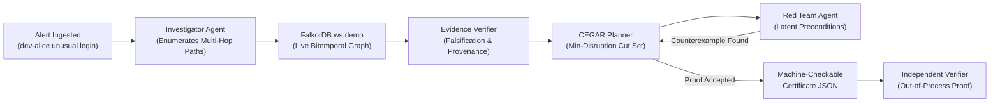

## 🎬 Video Walkthrough

<div style="position: relative; padding-bottom: 56.25%; height: 0; overflow: hidden; max-width: 100%; border-radius: 8px; margin: 20px 0;">
  <iframe src="https://www.youtube.com/embed/nerrSAtqa4w" title="GhostTrace Demo Video" style="position: absolute; top: 0; left: 0; width: 100%; height: 100%; border: 0;" allow="accelerometer; autoplay; clipboard-write; encrypted-media; gyroscope; picture-in-picture" allowfullscreen></iframe>
</div>

---

## 🏆 Hackathon Tracks Entered

GHOSTTRACE is entered into **all three tracks** of the WeMakeDevs Graph Hacks 2026:

| Track | Core Challenge | How GHOSTTRACE Solves It with FalkorDB |
|:---|:---|:---|
| **1 · Agents That Act on Connected Data** | Autonomous actions over dense connected data | Time-valid multi-hop attack path enumeration over bitemporal graphs. A CEGAR containment optimizer computes the **Price-of-Certainty curve** ($k=0,1,2$), verified out-of-process. |
| **2 · Agent Memory & Coordination** | Durable multi-agent swarm state | 5-agent swarm coordinating directly through FalkorDB atomic CAS leases, durable tasks, handoffs, and provenance-tracked memory that survives restarts. |
| **3 · Company Brain** | Live enterprise knowledge & ownership | Bitemporal organizational knowledge graph tracking ownership, dependencies, and runbooks across world time $T$ and knowledge time $\tau$, resolving conflicting CMDB records. |

---

## 🧠 Why FalkorDB is the Brain

> **"Without FalkorDB's low-latency graph traversal, our CEGAR verification loop and multi-agent state synchronization cannot resolve multi-hop evidence chains in real time."**

FalkorDB is the primary graph database and sits in the live path of every decision:



### 1. CEGAR Counterexample Loop & Multi-Hop Path Enumeration
```cypher
MATCH p=(s:Entity)-[*1..$depth]->(t:Entity)
WHERE s.id IN $sources AND t.id IN $targets
  AND all(r IN relationships(p) WHERE r.workspace_id = $ws AND r.edge_id IN $allowed AND (
    r.tx_from <= $tau AND (r.tx_to IS NULL OR $tau < r.tx_to)
    AND (r.valid_to IS NULL OR $T < r.valid_to)
    AND (r.valid_from IS NULL OR r.valid_from <= $T)
  ))
RETURN [r IN relationships(p) | r.edge_id] AS edge_ids, [n IN nodes(p) | n.id] AS node_ids LIMIT $limit
```

### 2. Atomic Compare-And-Set Task Leasing
```cypher
MATCH (t:AgentTask {task_id: $tid}) WHERE t.workspace_id = $ws AND
  (t.status = 'queued' OR (t.status = 'running' AND t.lease_expires_at < $now))
SET t.status = 'running', t.lease_owner = $owner, t.lease_expires_at = $exp,
    t.attempt_count = coalesce(t.attempt_count, 0) + 1, t.started_at = $now
RETURN properties(t);
```

---

## 🌐 Interactive Graph View

Experience the live graph visualization directly:
- **Lightweight Standalone View**: Open [`http://localhost:8000/graph-view`](http://localhost:8000/graph-view) served directly by FastAPI without needing Node/Vite.
- **Color-Coded by Agent Action**:
  - 🔵 **Blue**: Investigator discovered path & entities
  - 🟢 **Green**: Evidence Verifier approved (confirmed facts)
  - 🔴 **Red**: Red-Team counterexample / pruned via CEGAR
  - 🟣 **Purple**: Latent / $\kappa$ candidate state

---

## 🚀 Quick Navigation

- [System Architecture & 5-Agent Flow](/architecture)
- [The Hard Problem: Open-World Containment](/hard-problem)
- [Bitemporal Graph Schema](/graph-schema)
- [Formal Claims Ledger](/claims-ledger)
- [Evaluation Suite & Soundness Report](/evaluation)
- [REST API Specification](/api)
- [Judge FAQ & Architecture Highlights](/judge-faq)
